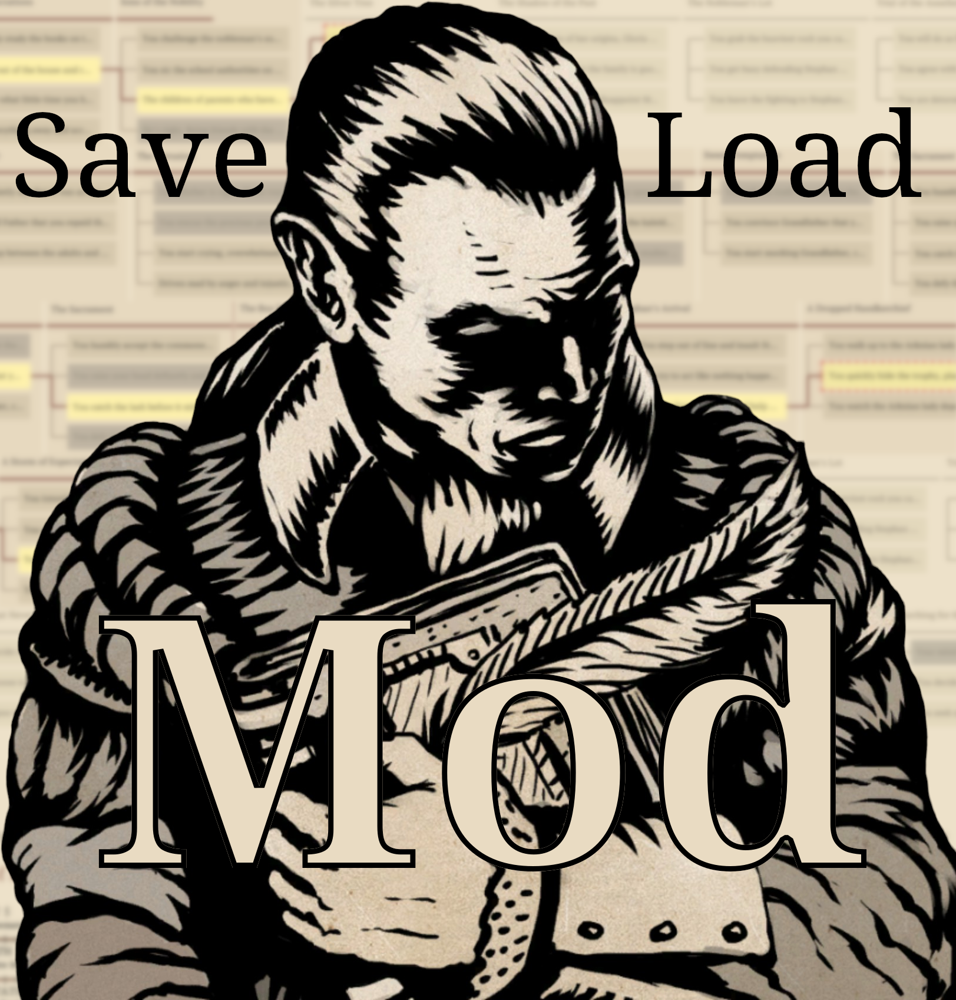
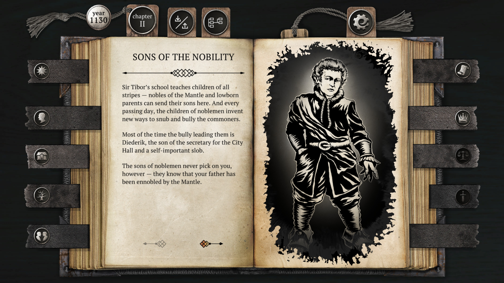
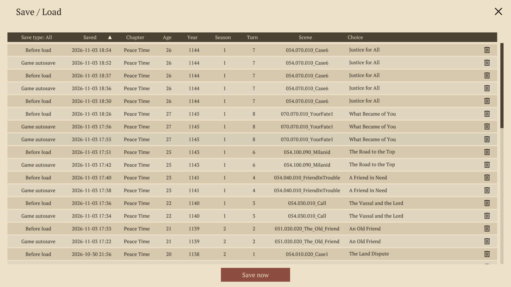

# Brante - Save / Load



A mod for [The Life and Suffering of Sir Brante](https://store.steampowered.com/app/1272160/) that lets you save scum.\
It also features a "tree view" visual of your playthrough so you can see your mistakes and poor life decisions (in the game, that is).

<br clear="right">



## What it does

- **Load any past scene (when you had to make a choice).** The mod records the exact game state at every scene. Then you can click the save / load tab on top of the book (the medallion with a down and an up arrow, next to the chapter tab), and pick any entry from the full-screen list to return to it.


- **Its own snapshots, and a backup of the game's save.** The mod uses the same folder as normal saves for automatic saves. Before you use the mod for the first time it copies the game's own save folder to a backup folder `Brante-Save-Load/Backups/<save>/` (with a `README.txt` saying how to put it back). After that, the game saves work normally again, exactly as it would after loading an older save from its own menu so autosaves keep working, and a chapter restart after a death continues *your* timeline.

- **You can save whenever you want.** This same window lists the automatic as well as your manual saves (made using the **"Save now"** button at the bottom). These saves are kept in `Brante-Save-Load/Runs/<main save ID>/`, separate from the game's saves to make sure it does not overwrite your original saves.

- **In your language.** The mod is translated into all eleven languages the game ships (English, Russian, German, French, Spanish, Italian, Polish, Turkish, Japanese, Korean, Simplified Chinese).

- **Iron Man included.** The game disables its own save/load menu in Iron Man but the mod's window keeps working there, so a permadeath run can still be rewound (cheater!).

- **A tree view of the whole story.** See below.

## Tree view


Click the tree view tab on top of the book (the medallion with linked boxes) to see the whole story as a tree, from left to right.
Scroll sideways with the mouse wheel.
The scrollbar also works as a progress bar showing how far you are in the story.

- **Columns are scenes, boxes are choices.** It shows every scene you went through, then everything still ahead until the end of chapter 5. "Current" and "Upcoming" mark where you are, and scenes that may not happen say what they depend on (stats, relationships, characters' fates or story events).
- **Your path is highlighted.** Your choices are in yellow, joined by a red line. Scenes played before the mod was installed have no recorded choice and say so.
- **Hover a choice** to see its full text, what it changes and what it requires (green if your hero meets it, red if not).
- **Click choices to build a path.** Click a picked choice again to undo it, or use the reset arrow next to the × to undo them all. Choices your hero can't take at that point are greyed out. If an earlier pick makes a later choice impossible, that choice turns red.
- **Your stats** are shown at the bottom, grouped like the game's tabs. They show your hero after your last pick (green if higher than now, red if lower). Hover a stat to see the game's own description of it. Tabs not unlocked yet at that chapter are greyed out.
- **Load scene** takes you to the scene with the red dashed outline, your furthest pick. Every scene before it needs a choice, and hovering the button tells you if something is missing or conflicting. The mod then plays through your choices by itself at ten times speed until it reaches that scene. If your hero dies on the way, it stops there so you can decide what to do.

## Install

```sh
./tools/install.sh              # symlink into the game folder
./tools/install.sh --copy       # copy instead
./tools/install.sh --uninstall  # remove the mod, keep your saves
```

The installer finds the game in your Steam libraries (distro package, Flatpak or Snap). Set `BRANTE_DIR` if your install isn't found automatically.
No .NET SDK is needed: the built DLL is in the repo. If you have one (≥ 6), the installer rebuilds it first.
Check that it worked by looking at `Brante-Save-Load/Brante-Save-Load.log` in the game folder after starting the game.

On Windows without bash, copy these into the game folder (next to `The Life and Suffering of Sir Brante.exe`):

1. the `Brante-Save-Load/` folder,
2. `doorstop/doorstop_config.ini`,
3. `vendor/doorstop/winhttp.dll`.

Under Proton (Linux / Steam Deck) the installer sets everything up. If the mod doesn't start, set the game's launch option in Steam to:

```
WINEDLLOVERRIDES=winhttp=n,b %command%
```

### Uninstall

`--uninstall` only removes what the mod added to the game folder. Your game saves, the mod's saves and the backup all stay.
Two extra flags:

- `--restore-backup` puts the backup of your original save back (the current one is moved to `Brante-Save-Load/PreRestore/` first, so nothing is lost).
- `--purge` deletes all of the mod's saves and backups.

## Known limitations

- Load scene needs a starting point before your first changed choice: a mod save, or the start of that chapter. For scenes played before the mod was installed, it starts from the chapter's start and you need to pick every choice from there.
- Future chapters only show the scenes shared by every path, since which path you get (your Lot, your post) isn't decided yet.
- Greyed-out choices after a changed pick are a close estimate: changes the game makes between scenes aren't simulated.
- Load scene takes about 5 to 10 seconds per scene to replay.
- Some stats (Love, Rule, Volition, Tolerance, Wrath, Control, Cruelty, Weight, Contention) have no description in the game itself.
- The game's saves don't sync with Steam Cloud (the developer has it turned off). Copy the `Saves` folder by hand to move them between computers.

## How it works

The game keeps its whole state in one object and has a public method to restore it.
The mod saves that object whenever a choice is on screen and loads it back later. It's exact, randomness included, since the dice have already been rolled by the time you see the choice.
The tree view uses three tables extracted from the game (`scene-flow.tsv`, `scene-texts.tsv`, `scene-effects.tsv`). After a game update, regenerate them with the scripts in `tools/` (see `docs/BRANCHES.md`).
More details in [docs/FINDINGS.md](docs/FINDINGS.md), and [AGENTS.md](AGENTS.md) for working on the mod.

## Building

```sh
./tools/build.sh        # compiles against the game's own DLLs
```

## Licence

GPL-3.0 (see LICENSE). Bundled: Unity Doorstop 4.6.0 (LGPL-2.1, vendor/doorstop/LICENSE), Lib.Harmony 2.3.3 (MIT, vendor/LICENSE-harmony.txt).
The game is Sever/101XP's; none of its files are in this repo. The thumbnail and screenshots show its art to illustrate the mod.
