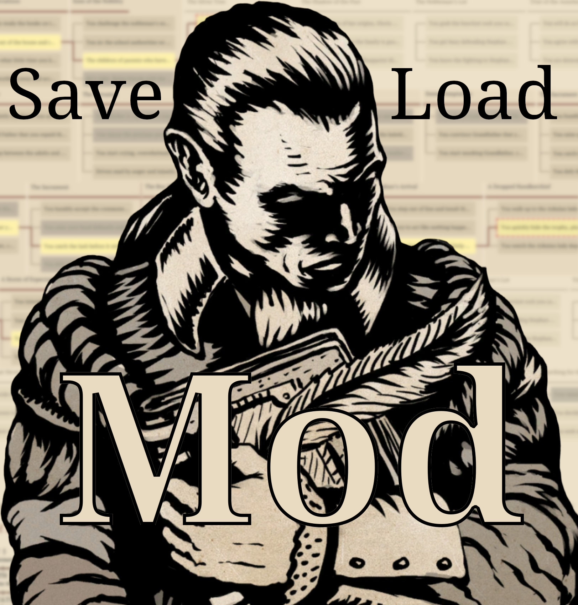
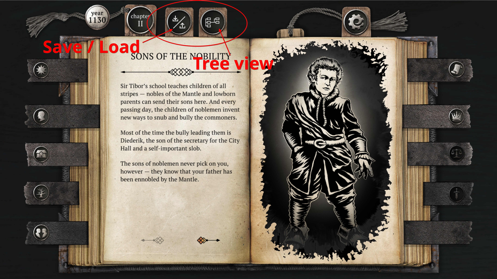
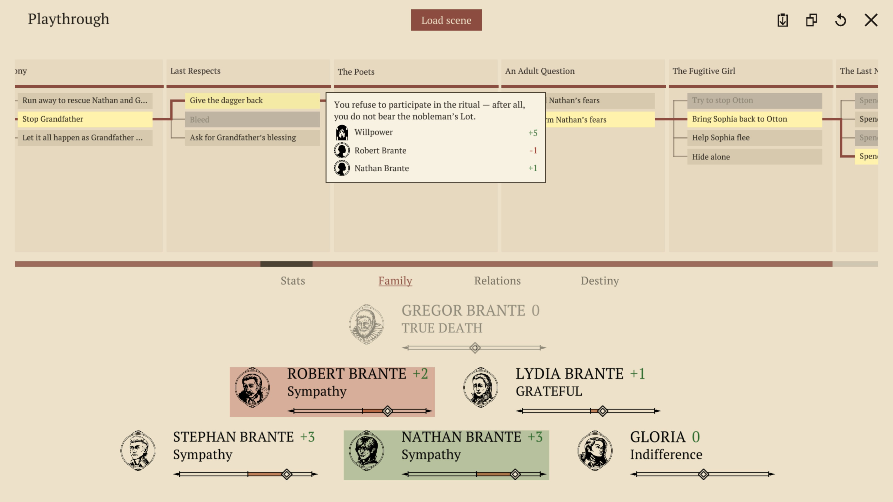
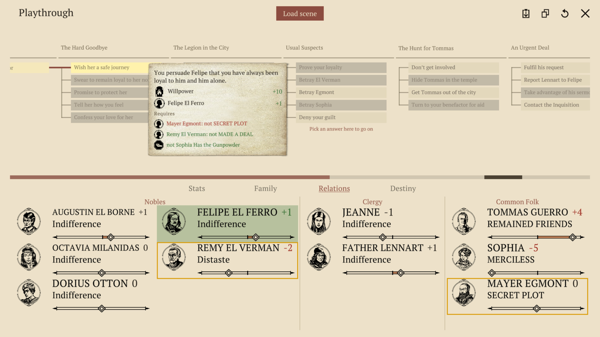

# Brante - Save / Load



A mod for [The Life and Suffering of Sir Brante](https://store.steampowered.com/app/1272160/) that lets you save scum.
It also features a "tree view" visual of your playthrough so you can see your mistakes and poor life decisions (in the game, that is).

<br clear="right">



## Install

### 1. Get the repo

Use **Code → Download ZIP** on GitHub and unzip it or if you have `git`:

```sh
git clone https://github.com/anton-scholten/Brante-Save-Load.git
```

### 2a. Linux (Steam / Proton)

```sh
cd Brante-Save-Load
./tools/install.sh
```

The script finds the game, links the mod folder into it and sets up Proton so the game starts with the mod.
Keep the repo where it is since the game's folder links to it.
Set `BRANTE_DIR` if the game isn't found.
If the mod doesn't start, set the Steam launch option to `WINEDLLOVERRIDES=winhttp=n,b %command%`.

### 2b. Windows

Open the game's folder: in Steam, right-click the game → **Manage** → **Browse local files**.
Go into the folder with `The Life and Suffering of Sir Brante.exe`.

Copy these three things from the repo into that folder, next to the `.exe`:

| From the repo | What you do |
|---|---|
| `Brante-Save-Load\` | copy the whole folder (the one *inside* the repo, with `Brante-Save-Load.dll` in it) |
| `doorstop\doorstop_config.ini` | copy just the file |
| `vendor\doorstop\winhttp.dll` | copy just the file |

The ZIP unpacks to `Brante-Save-Load-main\`: that is the repo, not the mod
folder. Copy the `Brante-Save-Load\` folder from inside it; the game folder
must not hold `Brante-Save-Load-main\` instead.
The game folder should then look like this:

```
The Life and Suffering of Sir Brante\
  The Life and Suffering of Sir Brante.exe
  Brante-Save-Load\
  doorstop_config.ini
  winhttp.dll
  ... other game files
```

### Play the game

Start the game as usual.
Two new tabs on top of the book mean the mod is running.

### Update to a newer version

Your saves are not in the mod's folder, so updating never touches them: the
mod keeps them with the game's own saves (on Windows in
`%USERPROFILE%\AppData\LocalLow\SEVER\The Life and Suffering of Sir Brante\Brante-Save-Load\`).
Close the game first.

- **Linux:** in the repo, `git pull` (or replace the repo folder with the new
  download, in the same place), then run `./tools/install.sh` again.
- **Windows:** delete the old `Brante-Save-Load\` folder from the game's folder
  and copy the new one in (copying over it could leave old files behind).
  Copy `doorstop_config.ini` and `winhttp.dll` again too, overwriting them;
  they rarely change, but that keeps everything from one version.

## Use

Two tabs appear on top of the book: **save / load** (the arrows) and **tree view** (the linked boxes).

### Save / Load


- Click a save to load it; the bin deletes it. **Save now** adds a save of your own.
- **Save type** (first header) filters: game autosaves, saves made before each load, your own saves, and the backup of your original save. Other headers sort.
- Every load first saves where you were, so any load can be undone.

### Tree view





- Columns are scenes, boxes are choices; your path is in red, with each choice made highlighted in yellow. Future scenes are predicted so only those that can happen are shown and your stats automatically lists the choices you can take.
- **Hover** a choice to see what it changes and requires; the stats it changes light up below (green up, red down).
- Events that happen without a choice but change your stats (Family Strife, the revolt's incidents, the finals, …) get a column of their own where they happen, played or predicted, with one box named after the event; hover it to read how it opens and what it changes.
- Under the tree, **Stats**, **Family** and **Relations** tabs show your stats or your relations with each character along the path (portrait, -5 to +5, and their status: dead, exiled, …): the family as its family tree, everyone else by estate (nobles, clergy, common folk).
- In chapters 1 and 2 the chapter-3 skills (Diplomacy, Valor, …) are shown faded with the values your stats would give them when chapter 3 starts, so you can see what an early choice does there.
- **Click** choices to build a new path. Click again to undo; the arrow by the × resets all. Greyed choices can't be taken; red ones conflict with an earlier pick.
- **Load scene** plays your path by itself (at 40× speed) up to the dashed choice, with a progress bar and time left; the game can't be clicked meanwhile, and **Stop** ends it on the scene it has reached. Every scene before it needs a choice; "Pick an answer here to go on" shows which one is missing.

### Fast-forward


- Progress and time estimates given during a fast-forward when you load a path using the tree view.
- A **Stop** button is available to drop you into the current scene.

## Update notes

- **13 Nov 2026:**
  - Stats, Family and Relations tabs under the tree.
  - Events that happen on their own get columns, with their names.
  - Answers show their short names.
  - Interludes and events count in the predicted stats.
  - Chapter-3 skills are projected in chapters 1-2.
  - Characters appear once met.
- **7 Nov 2026:** clearer install steps; `install.sh --copy` copies the game data too.
- **6 Nov 2026:**
  - Load scene shows progress, time left and a Stop button.
  - The tree no longer scrolls vertically.
  - Hovered answers mark the stats they change.
  - Fixes: the true-death CONTINUE button, and a double click on a menu save.
- **5 Nov 2026:**
  - Replays run at 40× speed.
  - The game's pop-ups are closed before a load.
  - Quick load was removed.
- **3 Nov 2026:**
  - The scenes ahead are simulated.
  - Achievements stay on.

## Good to know

- Your original save is backed up once to `Brante-Save-Load/Backups/`; the game's own saves keep working as normal.
- Achievements stay on. Works in Iron Man. In all eleven of the game's languages.
- The predicted scenes are a forecast: choices you haven't picked count as the first one open. If Load scene meets a scene it didn't expect, it stops there so you can pick and load again.
- Load scene takes about 2-3 s per scene.

## Uninstall

```sh
./tools/install.sh --uninstall                    # keeps all saves
./tools/install.sh --uninstall --restore-backup   # also puts your original save back
./tools/install.sh --uninstall --purge            # also deletes the mod's saves
```

## More

[docs/FINDINGS.md](docs/FINDINGS.md) explains how the game and the mod work, [MODDING.md](MODDING.md) is a compact how-to, and [AGENTS.md](AGENTS.md) covers working on the mod (build with `./tools/build.sh`).

## Licence

GPL-3.0 (see LICENSE). Bundled: Unity Doorstop 4.6.0 (LGPL-2.1, vendor/doorstop/LICENSE), Lib.Harmony 2.3.3 (MIT, vendor/LICENSE-harmony.txt).
The game is Sever/101XP's; none of its files are in this repo. The thumbnail and screenshots show its art to illustrate the mod.
