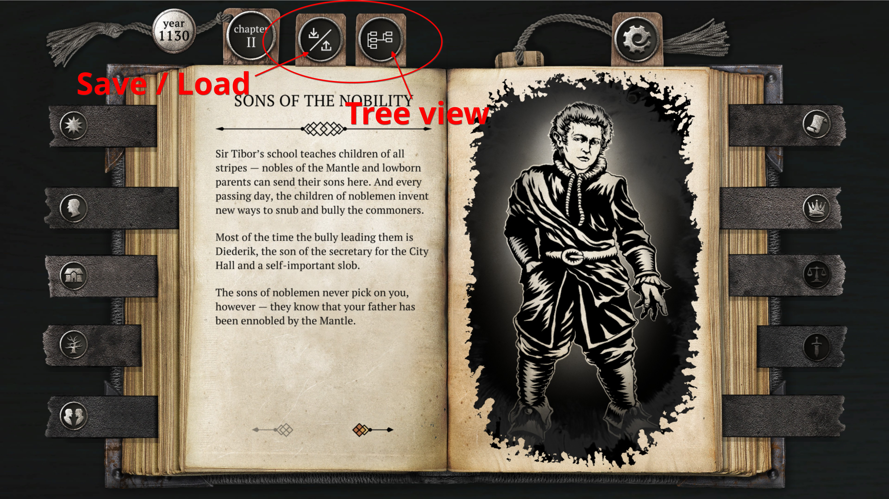
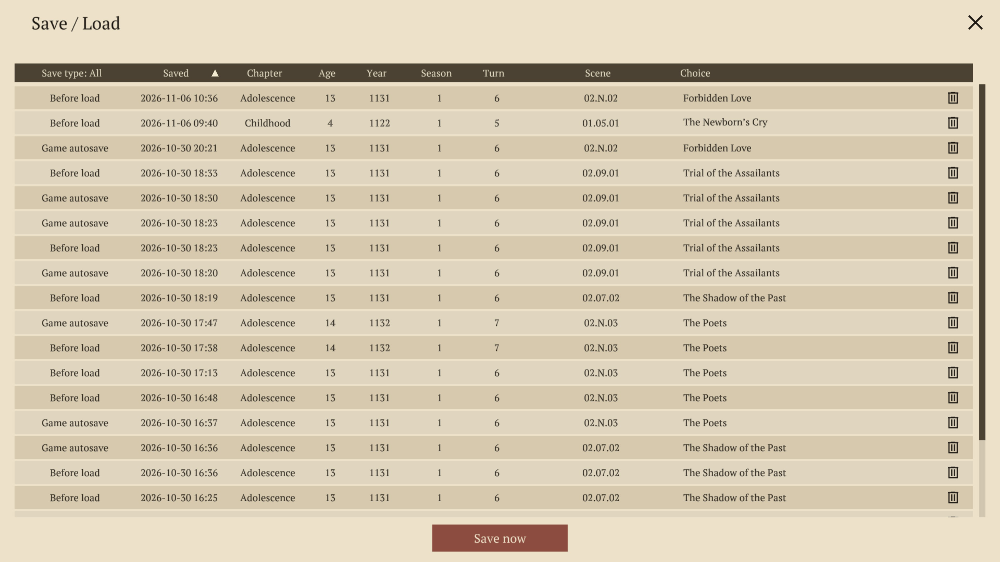
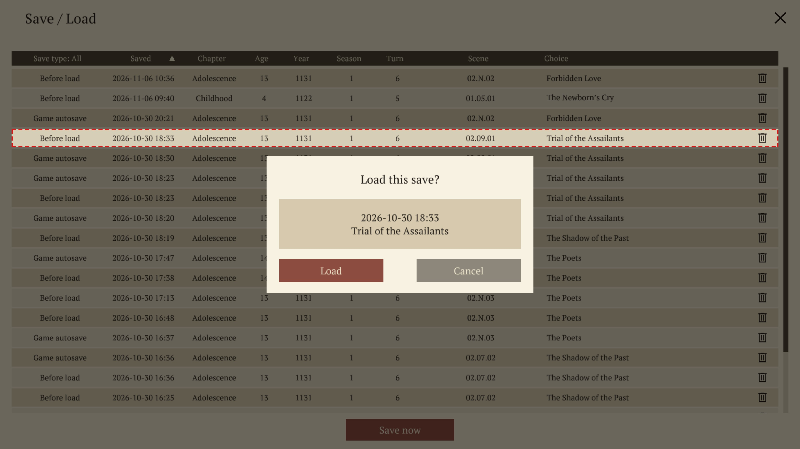
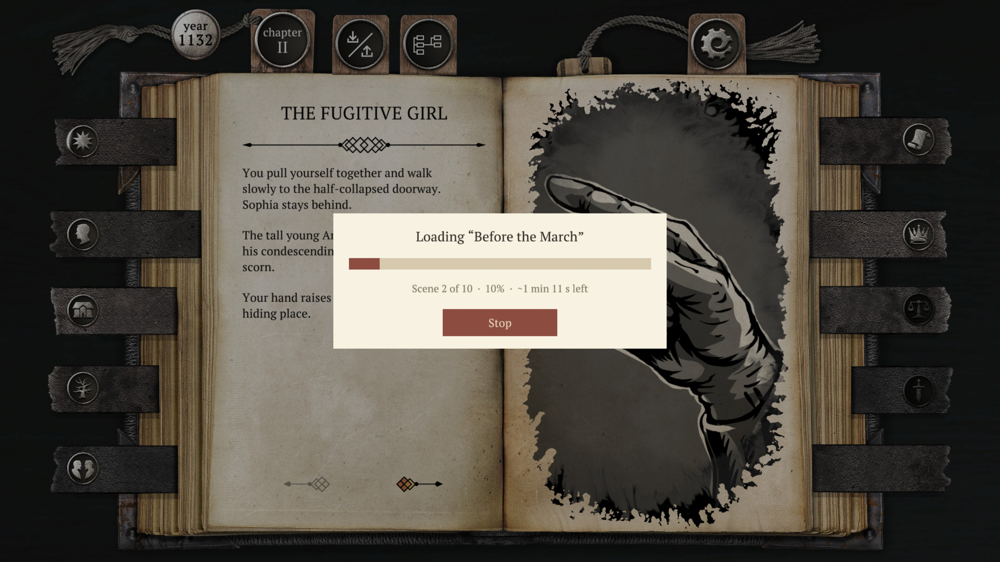

# Brante - Save / Load


A mod for [The Life and Suffering of Sir Brante](https://store.steampowered.com/app/1272160/) that lets you save scum.
It also features a "tree view" visual of your playthrough so you can see your mistakes and poor life decisions (in the game, that is).

<br clear="right">



## Install

The mod is already built (the DLL is in the repo), so no .NET SDK is needed.

### 1. Get the repo

```sh
git clone https://github.com/anton-scholten/Brante-Save-Load.git
```

Without git, use **Code → Download ZIP** on GitHub and unzip it.

### 2a. Linux (Steam / Proton)

```sh
cd Brante-Save-Load
./tools/install.sh
```

The script finds the game, links the mod folder into it and sets up Proton so the game starts with the mod.
Keep the repo where it is: the game folder links to it.
Set `BRANTE_DIR` if the game isn't found.
If the mod doesn't start, set the Steam launch option to `WINEDLLOVERRIDES=winhttp=n,b %command%`.

### 2b. Windows

Open the game's folder: in Steam, right-click the game → **Manage** → **Browse local files**.
It holds `The Life and Suffering of Sir Brante.exe`.

Copy these three things from the repo into that folder, next to the `.exe`:

| From the repo | What it is |
|---|---|
| `Brante-Save-Load\` | the **folder**, copied whole |
| `doorstop\doorstop_config.ini` | **just the file**, not the `doorstop` folder |
| `vendor\doorstop\winhttp.dll` | **just the file**, not the `vendor` folder |

The game folder should then look like this:

```
The Life and Suffering of Sir Brante\
  The Life and Suffering of Sir Brante.exe
  Brante-Save-Load\
  doorstop_config.ini
  winhttp.dll
  ...the game's own files
```

The two files only work loose next to the `.exe`: inside a subfolder the mod won't load.
Use `doorstop\doorstop_config.ini`, not the one in `vendor\doorstop\`.

Start the game as usual. Two new tabs on top of the book mean the mod is running.

## Use

Two tabs appear on top of the book: **save / load** (the arrows) and **tree view** (the linked boxes).

### Save / Load




- Click a save to load it; the bin deletes it. **Save now** adds a save of your own.
- **Save type** (first header) filters: game autosaves, saves made before each load, your own saves, and the backup of your original save. Other headers sort.
- Every load first saves where you were, so any load can be undone.

### Tree view


- Columns are scenes, boxes are choices; your path is in red, with each cchoice made highlighted in yellow. Future scenes are predicted so only those that can happen are shown and your stats automatically lists the choices you can take.
- **Hover** a choice to see what it changes and requires; the stats it changes light up below (green up, red down).
- **Click** choices to build a new path. Click again to undo; the arrow by the × resets all. Greyed choices can't be taken; red ones conflict with an earlier pick.
- **Load scene** plays your path by itself (at 40× speed) up to the dashed choice, with a progress bar and time left; the game can't be clicked meanwhile, and **Stop** ends it on the scene it has reached. Every scene before it needs a choice; "Pick an answer here to go on" shows which one is missing.

### Fast-forward



- Progress and time estimates given during a fast-forward when you load a path using the tree view.
- A **Stop** button is available to drop you into the current scene.

## Good to know

- Your original save is backed up once to `Brante-Save-Load/Backups/`; the game's own saves keep working as normal.
- Achievements stay on. Works in Iron Man. In all eleven of the game's languages.
- The predicted scenes are close but not exact (a few stat changes aren't in the game's tables). If Load scene meets a scene it didn't expect, it stops there so you can pick and load again.
- Load scene takes about 2-3 s per scene.

## Uninstall

```sh
./tools/install.sh --uninstall                    # keeps all saves
./tools/install.sh --uninstall --restore-backup   # also puts your original save back
./tools/install.sh --uninstall --purge            # also deletes the mod's saves
```

## More

[docs/FINDINGS.md](docs/FINDINGS.md) explains how the game and the mod work, [MODDING.md](MODDING.md) is a compact how-to, and [AGENTS.md](AGENTS.md) covers working on the mod (build with `./tools/build.sh`).

## Licence

GPL-3.0 (see LICENSE). Bundled: Unity Doorstop 4.6.0 (LGPL-2.1, vendor/doorstop/LICENSE), Lib.Harmony 2.3.3 (MIT, vendor/LICENSE-harmony.txt).
The game is Sever/101XP's; none of its files are in this repo. The thumbnail and screenshots show its art to illustrate the mod.
