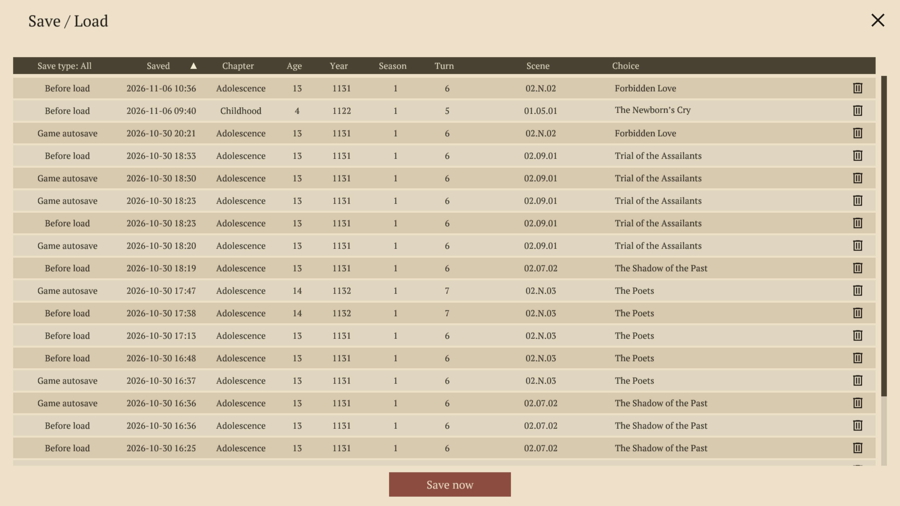
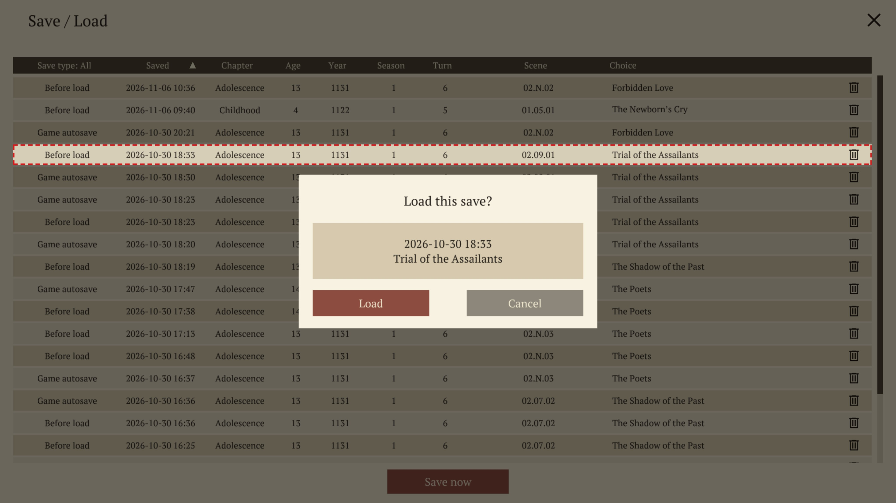
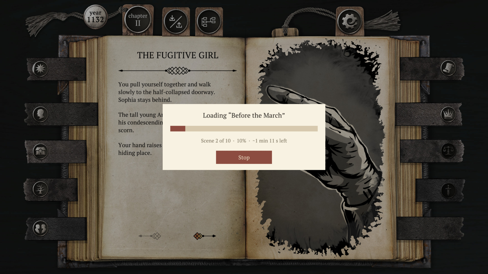

# Brante - Save / Load


A mod for [The Life and Suffering of Sir Brante](https://store.steampowered.com/app/1272160/) that lets you save scum.
It also features a "tree view" visual of your playthrough so you can see your mistakes and poor life decisions (in the game, that is).

<br clear="right">


## Install

### 1. Get the repo

Use **Code → Download ZIP** on GitHub and unzip it or if you have `git`:

```sh
git clone https://github.com/anton-scholten/Brante-Save-Load.git
```

### 2a. Linux (Steam / Proton)

```sh
cd Brante-Save-Load
./tools/install.sh
```

The script finds the game, links the mod folder into it and sets up Proton so the game starts with the mod.
Keep the repo where it is since the game's folder links to it.
Set `BRANTE_DIR` if the game isn't found.
If the mod doesn't start, set the Steam launch option to `WINEDLLOVERRIDES=winhttp=n,b %command%`.

### 2b. Windows

Open the game's folder: in Steam, right-click the game → **Manage** → **Browse local files**.
Go into the folder with `The Life and Suffering of Sir Brante.exe`.

Copy these three things from the repo into that folder, next to the `.exe`:

| From the repo | What you do |
|---|---|
| `Brante-Save-Load\` | copy the whole folder (the one *inside* the repo, with `Brante-Save-Load.dll` in it) |
| `doorstop\doorstop_config.ini` | copy just the file |
| `vendor\doorstop\winhttp.dll` | copy just the file |

The ZIP unpacks to `Brante-Save-Load-main\`: that is the repo, not the mod
folder. Copy the `Brante-Save-Load\` folder from inside it; the game folder
must not hold `Brante-Save-Load-main\` instead.
The game folder should then look like this:

```
The Life and Suffering of Sir Brante\
  The Life and Suffering of Sir Brante.exe
  Brante-Save-Load\
  doorstop_config.ini
  winhttp.dll
  ... other game files
```

### Play the game

Start the game as usual.
Two new tabs on top of the book mean the mod is running.

### Update to a newer version

Your saves are not in the mod's folder, so updating never touches them: the
mod keeps them with the game's own saves (on Windows in
`%USERPROFILE%\AppData\LocalLow\SEVER\The Life and Suffering of Sir Brante\Brante-Save-Load\`).
Close the game first.

- **Linux:** in the repo, `git pull` (or replace the repo folder with the new
  download, in the same place), then run `./tools/install.sh` again.
- **Windows:** delete the old `Brante-Save-Load\` folder from the game's folder
  and copy the new one in (copying over it could leave old files behind).
  Copy `doorstop_config.ini` and `winhttp.dll` again too, overwriting them;
  they rarely change, but that keeps everything from one version.

## Use

Two tabs appear on top of the book: **save / load** (the arrows) and **tree view** (the linked boxes).

### Save / Load




- Click a save to load it; the bin deletes it. **Save now** adds a save of your own.
- **Save type** (first header) filters: game autosaves, saves made before each load, your own saves, and the backup of your original save. Other headers sort.
- Every load first saves where you were, so any load can be undone.

### Tree view


- Columns are scenes, boxes are choices. Your path is red, your choices yellow. Scenes ahead are predicted.
- **Hover** a choice or scene name to see its text and what it changes.
- **Click** choices to make a new path (click again to undo, the arrow resets). **Load scene** plays it for you.
- Events (scenes without a choice) have their own column; click one to load it.
- **Stats / Family / Relations** tabs show where you stand after your last pick. Pale rows are people you would meet. Green and red show what your picks changed.
- **Destiny** lists the chapter's outcomes: happened, on this path, still possible, or out of reach. Hover one for what it requires and where it comes from; options that can no longer happen are crossed out.
- Greyed choices aren't open to you; red ones clash with an earlier pick.
- Faded stats unlock in a later chapter; the arrows show which two stats make each chapter-3 skill.
- A true death, or an ending that finishes the game, ends the path: no choices follow it.

### Path ID


- **Copy** puts the scene you are on and everything about it (stats, people, destinies, choices so far) on the clipboard as one line of text, about 1,000 characters.
- **Paste** loads one, e.g. from a friend, straight into that scene. Your game is saved as "Before load" first; the pasted one is listed under Manual.
- Path IDs work between copies of the same game version. Your hero keeps their name.

### Fast-forward



- **Load scene** plays your picked path at high speed, about 2-3 s a scene, with progress and time left.
- **Stop** drops you into the scene it has reached.

## Update notes

- **17 Nov 2026:**
  - Path IDs: copy your game as text, paste one to jump straight into it.
  - Destiny pop-ups show what an outcome requires and where it comes from; options that can no longer happen are crossed out one by one, and outcomes as soon as they can't happen.
  - Endings that finish the game (Glory to the Empire!, The Judgment of the Twins) end the path; Deaths shows True Death.
  - House and Personality stats in the game's own order.
  - Brazilian Portuguese and Traditional Chinese texts.
  - Fixed: the rebel's "The Final Hour", Glory to the Empire! after Clean Hands, chapter 4's scene order, and Tommas's New Life on every path. Load scene stops if the story ends early.
- **16 Nov 2026:**
  - Destiny tab: the chapter's outcomes, and what a choice brings or rules out.
  - Personality laid out by chapter; stats not yet unlocked are faded.
  - Missing choices restored (The Silence of the Gods, To the Death, The Road to the Top and others).
  - A true death ends the predicted path.
  - The tree keeps one height; mouse wheel and scroll bar scroll the same way.
  - Fixed: colours compared with today's stats instead of the scene's.
- **13 Nov 2026:**
  - Stats, Family and Relations tabs under the tree.
  - Events that happen on their own get columns, with their names.
  - Answers show their short names.
  - Interludes and events count in the predicted stats.
  - Chapter-3 skills are projected in chapters 1-2.
  - Characters appear once met; hovering shows those you would meet as pale rows.
  - Hovering a scene's name shows the text beside its choices.
  - Events can be loaded like choices.
  - Personality stats are grouped by occupation; Deaths sits under Willpower; Heir is gone.
  - Fixed: scenes with an odd title key (The Vassal and the Lord) show their name.
  - Fixed: answers that decide a chapter's ending (A Sleepless Night, The Final Step, The Hour Has Come, and others) now lead to the right next scene in the tree.
- **7 Nov 2026:** clearer install steps; `install.sh --copy` copies the game data too.
- **6 Nov 2026:**
  - Load scene shows progress, time left and a Stop button.
  - The tree no longer scrolls vertically.
  - Hovered answers mark the stats they change.
  - Fixes: the true-death CONTINUE button, and a double click on a menu save.
- **5 Nov 2026:**
  - Replays run at 40× speed.
  - The game's pop-ups are closed before a load.
  - Quick load was removed.
- **3 Nov 2026:**
  - The scenes ahead are simulated.
  - Achievements stay on.

## Good to know

- Your original save is backed up once to `Brante-Save-Load/Backups/`; the game's own saves keep working as normal.
- Achievements stay on. Works in Iron Man and in all of the game's languages.
- The predicted scenes are a forecast: choices you haven't picked count as the first one open. If Load scene meets a scene it didn't expect, it stops there so you can pick and load again.

## Uninstall

**Windows:** delete `Brante-Save-Load\`, `doorstop_config.ini` and `winhttp.dll`
from the game's folder. The mod's saves stay in
`%USERPROFILE%\AppData\LocalLow\SEVER\The Life and Suffering of Sir Brante\Brante-Save-Load\`;
delete that folder too to remove them.

**Linux:**

```sh
./tools/install.sh --uninstall                    # keeps all saves
./tools/install.sh --uninstall --restore-backup   # also puts your original save back
./tools/install.sh --uninstall --purge            # also deletes the mod's saves
```

## More

[docs/FINDINGS.md](docs/FINDINGS.md) explains how the game and the mod work, [MODDING.md](MODDING.md) is a compact how-to, and [AGENTS.md](AGENTS.md) covers working on the mod (build with `./tools/build.sh`).

## Acknowledgements
Thanks to SVR7 for his help identifying missing and incorrect information listed by the mod as well as layout suggestions that greatly improved the final look of the tree view.

## Licence

GPL-3.0 (see LICENSE). Bundled: Unity Doorstop 4.6.0 (LGPL-2.1, vendor/doorstop/LICENSE), Lib.Harmony 2.3.3 (MIT, vendor/LICENSE-harmony.txt).
The game is Sever/101XP's; none of its files are in this repo. The thumbnail and screenshots show its art to illustrate the mod.
