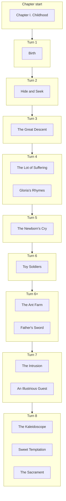
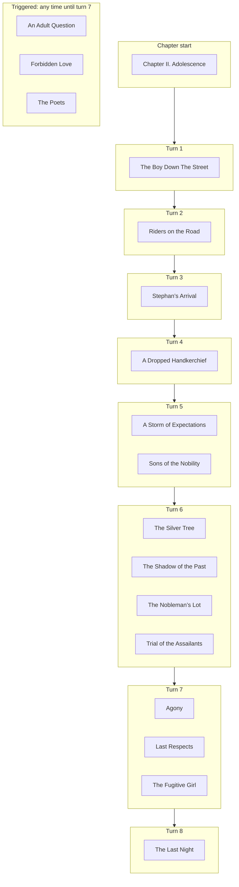

# The story, scene by scene

Every scene of *The Life and Suffering of Sir Brante*: when it plays, what it needs,
what it says, and every choice with what it requires, changes and earns. Generated
from the game's own data (`tools/story_doc.py`, from the mod's `scene-list.tsv`), in
the game's English.

How to read a scene:

- **When**: the time slot the chapter's flow opens it in (turn, season). No time:
  it follows in flow order, or is triggered as soon as its condition holds.
- **Track**: the story switches it needs - the post in chapters 4 and 5, and the
  switches a choice sets (with the choices that set them).
- **Opens when**: the scene's own condition (stats, people, destinies, scenes seen).
- **On opening / Earns**: what the scene does by itself, whatever is chosen.
- Each choice's **Requires** must hold for it to be picked; **Effects** and
  **Destinies** follow when it is; **Sets** are the switches it turns.

In the charts each box is a time slot, top to bottom in time; ◇ marks a scene with a condition,
rounded boxes are events (no choice).

## [Chapter I. Childhood](chapter-1.md)

## [Chapter II. Adolescence](chapter-2.md)

## [Chapter III. Youth](chapter-3.md)

```mermaid
flowchart TD
  subgraph G0["Chapter start"]
    direction LR
    youthchapterstart["Chapter III. Youth"]
  end
  subgraph G1["Turn 1"]
    direction LR
    030_010_010_culturalshock["Arrival in the Capital"]
    030_010_015_lukapreach["Luke’s Sermon"]
    030_010_020_oppositeetern["The City That Never Sleeps"]
  end
  subgraph G2["Turn 2"]
    direction LR
    030_010_030_meetsofia["The Girl from Your Past"]
    030_020_010_exam["The Three Lots"]
    030_020_020_tommaspath["Bonds of Friendship"]
    030_030_010_studbrothers["◇ The Ball"]
    030_030_020_religiousdisput["◇ Searching for the Truth"]
    030_030_030_recruitment["◇ The Lotless"]
  end
  subgraph G3["Turn 3"]
    direction LR
    030_040_010_officersclub["◇ Sir El Croix’s Lesson"]
    030_050_010_firstcase["◇ The First Case"]
    030_040_020_legacyoftheevilages["◇ The Black Book"]
    030_050_020_sermon["◇ Matters of Faith"]
    030_040_030_preparation["◇ Before the March"]
    030_050_030_action["◇ March of the Collars"]
  end
  subgraph G4["Turn 4"]
    direction LR
    030_060_010_greatarkns["◇ A Great Feast for All"]
    030_070_010_graduation["◇ The Way of the Sword"]
    030_080_010_departure_noble("◇ A Farewell to the Capital")
    030_060_020_patriarchunius["◇ A Criminal Relationship"]
    030_070_020_takingthegown["◇ The Second Sacrament"]
    030_080_010_departure_cleric("◇ A Farewell to the Capital")
    030_060_030_hiddenrevealed["◇ The Trap Springs"]
    030_070_030_recruitforreal["◇ Recruitment"]
    030_080_010_departure_bourgeois("◇ A Farewell to the Capital")
  end
  G0 --> G1
  G1 --> G2
  G2 --> G3
  G3 --> G4
```

## [Chapter IV. Peace Time](chapter-4.md)

**Every post**

```mermaid
flowchart TD
  subgraph G0["Turn 1, season 2"]
    direction LR
    051_010_010_scene_1["A Reception at the Brante Residence"]
    051_010_020_scene_2["A Rock and a Hard Place"]
  end
  subgraph G1["Turn 2+"]
    direction LR
    051_090_040_minuteofrest("◇ A Moment of Respite")
  end
  subgraph G2["Turns 2-7"]
    direction LR
    051_090_050_richfamily["◇ A Family of Means"]
    051_090_060_gloriousfamily("◇ A Glorious Bloodline")
  end
  subgraph G3["Turn 2, season 1"]
    direction LR
    051_020_010_scene_3["A Gift for the Family"]
  end
  subgraph G4["Turn 2, season 2"]
    direction LR
    051_020_020_the_old_friend["An Old Friend"]
  end
  subgraph G5["Turn 2, season 3"]
    direction LR
    051_020_030_the_call_of_the_ancestors["The Call of the Ancestors"]
  end
  subgraph G6["Turn 3, season 2"]
    direction LR
    051_030_010_scene_4["Brothers in Misery"]
  end
  subgraph G7["Turn 4, season 2"]
    direction LR
    051_040_010_scene_7["The Festival of the Silver Tree"]
  end
  subgraph G8["Turn 5, season 2"]
    direction LR
    051_050_010_scene_10["◇ Stephan’s Gambit"]
    051_050_020_scene_11["◇ The Illegitimate Girl"]
  end
  subgraph G9["Turns 6-7"]
    direction LR
    051_090_030_stigmaofshame("◇ The Mark of Dishonor")
  end
  subgraph G10["Turn 6"]
    direction LR
    051_060_030_mortally["◇ To the Death"]
  end
  subgraph G11["Turn 6+, season 2"]
    direction LR
    051_060_040_huntforthomas["◇ The Hunt for Tommas"]
  end
  subgraph G12["Turn 6, season 3"]
    direction LR
    051_060_010_rebelliousgirl["◇ The Rebel"]
    051_060_020_lesserevil["◇ The Lesser Evil"]
  end
  subgraph G13["Turn 7"]
    direction LR
    051_070_035_mortally["◇ To the Death"]
  end
  subgraph G14["Turn 7, season 2"]
    direction LR
    051_070_010_deathbed["Deathbed"]
  end
  subgraph G15["Turn 7, season 3"]
    direction LR
    051_070_020_brokenbranch["◇ A Broken Branch"]
    051_070_030_goldencage["◇ The Gilded Cage"]
    051_070_025_gloriafrombrante("◇ Gloria of House Brante")
    051_070_026_gloriafrombrante("◇ Gloria of House Brante")
    051_070_040_interruptedwedding("◇ The Runaway Bride")
    051_070_050_thomaswedding["◇ Tommas’s Wedding"]
    051_070_060_repentance["Repentance"]
  end
  subgraph G16["Turn 8, season 1"]
    direction LR
    051_070_070_familycouncil["A Family Matter"]
    051_070_080_nobleblood["◇ A Noble Bloodline"]
  end
  subgraph G17["Triggered: any time until turn 8"]
    direction LR
    051_090_010_familyquarrel("◇ Family Strife")
  end
  subgraph G18["Triggered: any time until turn 7"]
    direction LR
    051_090_020_devastation("◇ Ruin and Debt")
  end
  G0 --> G1
  G1 --> G2
  G2 --> G3
  G3 --> G4
  G4 --> G5
  G5 --> G6
  G6 --> G7
  G7 --> G8
  G8 --> G9
  G9 --> G10
  G10 --> G11
  G11 --> G12
  G12 --> G13
  G13 --> G14
  G14 --> G15
  G15 --> G16
```

**[Inquisitor (Priest track)](chapter-4-inquisitor.md)**

```mermaid
flowchart TD
  subgraph G0["Turn 1, season 1"]
    direction LR
    052_010_001_guidance["Spiritual Guidance"]
    051_000_020_arrive_inquisitor["Homecoming"]
    052_010_005_cassii["The Sacred Conclave"]
  end
  subgraph G1["Turn 2, season 1"]
    direction LR
    052_010_020_case2["The La-Tari Society"]
  end
  subgraph G2["Turn 2, season 2"]
    direction LR
    052_020_010_case3["In the Shadow of the Tree"]
  end
  subgraph G3["Turn 2, season 3"]
    direction LR
    052_010_010_case1["The Will and the Law"]
  end
  subgraph G4["Turn 3+"]
    direction LR
    052_n8_010_trigger8["◇ The Fire"]
  end
  subgraph G5["Turn 3, season 1"]
    direction LR
    052_030_010_case4["The Printed Page"]
  end
  subgraph G6["Turns 4-6"]
    direction LR
    052_n3_010_trigger3["◇ The Principle of the Will"]
    052_n9_010_trigger9["◇ Lethal Weapons"]
  end
  subgraph G7["Turn 4, season 1"]
    direction LR
    052_040_010_case5["Miracles and Wonders"]
  end
  subgraph G8["Turn 5, season 1"]
    direction LR
    052_050_020_case7["The Trail of Sorcery"]
    052_050_010_case6["Revelation"]
  end
  subgraph G9["Turn 5, season 2"]
    direction LR
    052_050_025_confession["A Confession"]
  end
  subgraph G10["Turn 6, season 1"]
    direction LR
    052_050_026_patriarchpreaching["The Patriarch’s Sermon"]
  end
  subgraph G11["Turn 7, season 1"]
    direction LR
    052_050_030_case8["A Sinner’s Confession"]
    052_060_010_case9["The Renegade"]
    052_060_020_case10["◇ The Sentence"]
  end
  subgraph G12["Turn 7, season 3"]
    direction LR
    052_060_030_reported["The Denunciation"]
  end
  subgraph G13["Turn 8"]
    direction LR
    052_n5_010_trigger5("◇ The Reflection")
    052_n13_010_heretic("◇ The Heretic")
    052_n11_010_trigger11("◇ Day of Wrath")
    052_n6_010_trigger6["◇ The Triumph of the Will"]
    052_n12_010_trigger12["◇ The Silence of the Gods"]
    052_210_010_final1("◇ The Path of the Will")
    052_210_020_final2("◇ The Flame of the New Faith")
    052_070_010_case11["The Final Step"]
    052_210_030_final3("◇ The Tribunal")
    052_210_040_final4("◇ Cassius’s Downfall")
    052_210_050_final5("◇ Wrath of the Gods")
    052_210_060_final6("◇ The Path of the Will")
    052_210_065_final7["◇ The Judgment of the Twins"]
  end
  subgraph G14["Triggered: any time until turn 7"]
    direction LR
    052_n1_010_trigger1["◇ Evening Prayer"]
    052_n2_010_trigger2["◇ The Captive"]
    052_n4_010_trigger4["◇ Privilege and Authority"]
    052_n7_010_trigger7["◇ Night of Sword and Lash"]
    052_n10_010_trigger10["◇ The New Sacrament"]
  end
  G0 --> G1
  G1 --> G2
  G2 --> G3
  G3 --> G4
  G4 --> G5
  G5 --> G6
  G6 --> G7
  G7 --> G8
  G8 --> G9
  G9 --> G10
  G10 --> G11
  G11 --> G12
  G12 --> G13
```

**[Judge (Noble track)](chapter-4-judge.md)**

```mermaid
flowchart TD
  subgraph G0["Turn 0+"]
    direction LR
    054_100_010_martiallaw["◇ March of the Desperate"]
  end
  subgraph G1["Turn 1, season 1"]
    direction LR
    051_000_030_arrive_prefect["Homecoming"]
    054_010_010_firstdaywork["First Day of Service"]
  end
  subgraph G2["Turn 1, season 2"]
    direction LR
    054_010_020_case1["The Land Dispute"]
  end
  subgraph G3["Turn 2, season 1"]
    direction LR
    054_020_010_el_born["The Power of the Law"]
  end
  subgraph G4["Turn 2, season 2"]
    direction LR
    054_020_020_case2["The Newspaper Case"]
  end
  subgraph G5["Turn 3, season 1"]
    direction LR
    054_030_010_call["The Vassal and the Lord"]
    054_030_020_passion["Passion"]
  end
  subgraph G6["Turn 3, season 2"]
    direction LR
    054_030_030_case3["The Case of Father Mark"]
  end
  subgraph G7["Turns 4-7"]
    direction LR
    054_100_030_rotshild["◇ Friend of the People"]
    054_100_090_milanid["◇ The Road to the Top"]
  end
  subgraph G8["Turn 4, season 1"]
    direction LR
    054_040_010_friendintrouble["A Friend in Need"]
    054_040_020_helpfriend["The Case against Otton"]
  end
  subgraph G9["Turn 4, season 2"]
    direction LR
    054_040_040_octaviadate["◇ A Rendezvous with Octavia"]
    054_040_050_octaviadate["◇ A Rendezvous with Octavia"]
  end
  subgraph G10["Turn 5, season 1"]
    direction LR
    054_050_010_huntforevidence["The Search for Evidence"]
  end
  subgraph G11["Turns 5-7, season 2"]
    direction LR
    054_100_100_present["◇ An Audience with the Overseer"]
  end
  subgraph G12["Turn 5, season 2"]
    direction LR
    054_050_020_smallvictory["A Realm Unknown"]
  end
  subgraph G13["Turn 6, season 1"]
    direction LR
    054_060_010_threatsandpromises["Threats and Promises"]
    054_060_020_case5["Nobleman’s Honor"]
  end
  subgraph G14["Turn 6, season 2"]
    direction LR
    054_060_030_witness["◇ The Hunt for Tommas"]
    054_060_040_rebelsentence["El Ferro's List"]
  end
  subgraph G15["Turn 7, season 1"]
    direction LR
    054_070_010_case6["Justice for All"]
  end
  subgraph G16["Turn 7, season 2"]
    direction LR
    054_070_020_alatari["Transformation"]
  end
  subgraph G17["Turn 8"]
    direction LR
    054_080_120_final3("◇ Night of the Serpents")
    054_080_140_final_judgefall("◇ The Fall of Judge Brante")
  end
  subgraph G18["Turn 8, season 1"]
    direction LR
    054_080_010_final1("Broken Chains")
    054_080_030_aftermath("The Smell of Gunpowder")
    054_080_020_final2("◇ Night of the Serpents")
    054_080_080_miserable("◇ Forsaken")
  end
  subgraph G19["Turn 8+, season 1"]
    direction LR
    054_080_040_arrest["◇ Prisoners"]
    054_080_050_duty("The Empty Chair")
    054_080_060_trap["Twilight over Anizotte"]
  end
  subgraph G20["Turn 8, season 2"]
    direction LR
    054_080_070_finalpreparations["Final Preparations"]
    054_080_090_court["The Hour Has Come"]
    054_080_100_final5("◇ A Lesson Writ in Blood")
    054_080_130_final6("◇ Otton’s Sentence")
    054_080_110_final4("◇ Otton and the Court of Honor")
  end
  subgraph G21["Triggered: any time until turn 7"]
    direction LR
    054_100_020_pickets["◇ The Crowded Square"]
    054_100_040_abuseofauthority["◇ Debacle in the Shop"]
    054_100_080_snakes["◇ Chutes and Ladders"]
    054_100_070_dismissal["◇ Invitation to the Ball"]
  end
  subgraph G22["Triggered: any time until turn 6, season 2"]
    direction LR
    054_040_030_reckoning["◇ Payback"]
  end
  G0 --> G1
  G1 --> G2
  G2 --> G3
  G3 --> G4
  G4 --> G5
  G5 --> G6
  G6 --> G7
  G7 --> G8
  G8 --> G9
  G9 --> G10
  G10 --> G11
  G11 --> G12
  G12 --> G13
  G13 --> G14
  G14 --> G15
  G15 --> G16
  G16 --> G17
  G17 --> G18
  G18 --> G19
  G19 --> G20
```

**[Rebel (Lotless track)](chapter-4-rebel.md)**

```mermaid
flowchart TD
  subgraph G0["Turn 1, season 1"]
    direction LR
    051_000_040_arrive_rebel["Homecoming"]
    053_010_010_firststeps["First Steps"]
  end
  subgraph G1["Turn 1, season 2"]
    direction LR
    053_010_020_call["The Last Straw"]
    053_010_030_case1["Hearts on Fire"]
  end
  subgraph G2["Turn 2, season 1"]
    direction LR
    053_020_010_rotshild["Concerned Сitizen"]
  end
  subgraph G3["Turn 2, season 2"]
    direction LR
    053_050_010_powder["The Gunpowder Plot"]
  end
  subgraph G4["Turn 2, season 3"]
    direction LR
    053_050_011_youthmistakes["The Errors of Youth"]
  end
  subgraph G5["Turns 3-6"]
    direction LR
    053_100_030_offersofya["◇ Powder Keg"]
    053_100_090_chancellor["◇ Trust"]
  end
  subgraph G6["Turn 3, season 1"]
    direction LR
    053_050_012_visitingtheburgomaster["A Chat with the Magistrate"]
  end
  subgraph G7["Turn 3, season 2"]
    direction LR
    053_030_010_case2["Freedom of Speech"]
  end
  subgraph G8["Turn 4, season 1"]
    direction LR
    053_040_010_case3["Blast Wave"]
  end
  subgraph G9["Turn 5, season 1"]
    direction LR
    053_050_020_smallvictory["An Invitation to Dinner"]
  end
  subgraph G10["Turn 5, season 2"]
    direction LR
    053_050_021_doriyotton["Getting Even"]
  end
  subgraph G11["Turn 6"]
    direction LR
    053_100_130_suspicions["◇ Usual Suspects"]
  end
  subgraph G12["Turn 6, season 1"]
    direction LR
    053_050_030_seconddate["The Hard Goodbye"]
    053_060_010_enteringtroops["The Legion in the City"]
  end
  subgraph G13["Turn 6, season 2"]
    direction LR
    053_060_020_ironphilippe["An Urgent Deal"]
  end
  subgraph G14["Turn 7"]
    direction LR
    053_100_140_profitableyear("◇ A Banner Year")
  end
  subgraph G15["Turn 7, season 1"]
    direction LR
    053_060_030_dangerouscargo["A Dangerous Haul"]
  end
  subgraph G16["Turn 8, season 1"]
    direction LR
    053_100_050_aftermath("◇ Explosion")
    053_100_060_arrestsofya["◇ The Greater Good"]
    053_100_110_aftermath2("◇ Mutually Beneficial Collaboration")
    053_100_120_disclosure["◇ Clean Hands"]
  end
  subgraph G17["Turn 8, season 2"]
    direction LR
    053_090_060_final6("◇ Glory to the Empire!")
    053_070_010_bridges["A Sleepless Night"]
    053_090_010_final1("◇ The Last Straw’s Revolt")
    053_080_010_secretmeet["◇ Masks Off"]
    053_090_030_final3("◇ The Free City")
    053_090_050_final5("◇ A Free Man")
    053_090_040_final4("◇ The Master of Anizotte")
    053_090_020_final2("◇ Farewell, Advisor!")
  end
  subgraph G18["Triggered: any time until turn 7"]
    direction LR
    053_100_080_tortures["◇ A Sound of Thunder"]
    053_100_070_catastrophe2["◇ At Midnight"]
    053_100_100_lynch["◇ Personal Interests"]
    053_100_020_arrest["◇ Hand of the Law"]
    053_100_010_catastrophe1["◇ Raid"]
    053_100_040_pogrom["◇ Sound and Fury"]
  end
  G0 --> G1
  G1 --> G2
  G2 --> G3
  G3 --> G4
  G4 --> G5
  G5 --> G6
  G6 --> G7
  G7 --> G8
  G8 --> G9
  G9 --> G10
  G10 --> G11
  G11 --> G12
  G12 --> G13
  G13 --> G14
  G14 --> G15
  G15 --> G16
  G16 --> G17
```

## [Chapter V. The Revolt](chapter-5.md)

```mermaid
flowchart TD
  subgraph G0["Chapter start"]
    direction LR
    insurrectionchapterstart("Chapter V. The Revolt")
  end
  subgraph G1["Turn 1"]
    direction LR
    insurrection_incident_1("◇ The Revolt Begins")
    insurrection_incident_2_2("◇ The Revolt Begins")
    insurrection_incident_2("◇ The Revolt Begins")
    insurrection_incident_3("◇ The Revolt Begins")
    insurrection_incident_4("◇ The Revolt Begins")
    insurrection_incident_5("◇ The Revolt Begins")
    insurrection_incident_6("◇ The Revolt Begins")
    insurrection_incident_7("◇ The Revolt Begins")
    insurrection_incident_8("◇ The Revolt Begins")
    insurrection_incident_9("◇ The Revolt Begins")
    insurrection_incident_10("◇ The Revolt Begins")
    insurrection_incident_11("◇ The Revolt Begins")
    insurrection_incident_12("◇ The Revolt Begins")
    insurrection_incident_13("◇ The Revolt Begins")
    060_010_010_familyfate["◇ The Family’s Fate"]
    060_010_020_godswill["◇ By Their Will"]
    060_010_030_escapefromthecity["◇ Escape from Anizotte"]
    060_010_040_gatheringforces["Mustering the Forces"]
    060_010_005_toarms_revolt("◇ To Arms")
    060_010_050_dyinglight["◇ A Fading Light"]
    060_010_060_elbornchoice["◇ Sir El Borne’s Choice"]
    060_010_070_huntedbeast["◇ A Cornered Beast"]
    060_010_080_ordersprit["◇ The Order, Divided"]
    060_010_090_prefecturesiege["The Prefecture under Siege"]
    060_010_100_ottonduel["◇ The Duel with Otton"]
    060_010_110_newfaithprocession["The March of the New Faith"]
    060_010_120_farewellwithjeanne["◇ A Farewell to Jeanne"]
    060_010_130_chiefoftheriot["The Rebel Leader"]
    060_010_140_ifyourhouseisdeartoyou["◇ Hearth and Home"]
    060_010_150_thefinalhour1["◇ The Final Hour"]
    060_010_160_thefinalhour2["◇ The Final Hour"]
    060_010_170_thefinal1["◇ The Battle for Anizotte"]
    060_010_180_thefinal2["◇ The Battle for Anizotte"]
    060_010_200_thefinal4["◇ The Battle for Anizotte"]
    060_010_190_thefinal3["◇ The Battle for Anizotte"]
    060_010_210_thefinal5["◇ A New Day Dawns"]
  end
  G0 --> G1
```

## [The finale and other pages](finale.md)

The true death, the endings and the fates told after them: scenes the chapter
flows do not open themselves.
